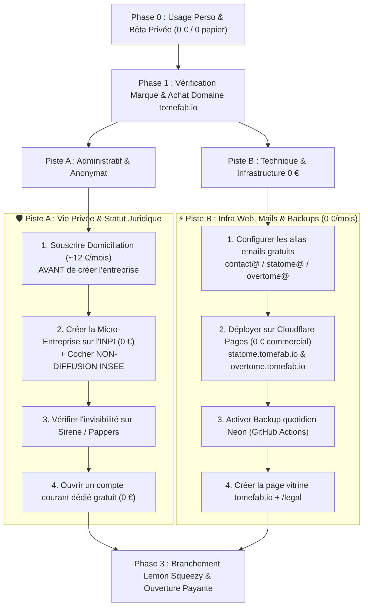

# 🚀 Guide Complet de Lancement : Écosystème TomeFab (`tomefab.io` — Overtome & Statome)

Ce document récapitule l'intégralité de la feuille de route **administrative, juridique, protection de la vie privée (anonymat) et technique** pour faire évoluer **Statome** et **Overtome** sous la marque ombrelle **TomeFab** (*La fabrique des tomes* / clin d'œil à *Fable* & *FabLab*), avec un budget de **0 € / mois de frais fixes** hors domiciliation.

> [!NOTE]
> **Pourquoi la symétrie `TomeFab` (Entreprise) vs `Overtome` / `Statome` (Applications) est idéale :**
> * **L'entreprise commence par `Tome-`** : **TomeFab** (*la fabrique*) → On identifie immédiatement le studio créateur.
> * **Les applications finissent par `-tome`** : **Overtome**, **Statome** → On identifie immédiatement les produits de la gamme.
> * Les 4 domaines **`tomefab.io`**, **`tomefab.com`**, **`tomefab.fr`** et **`tomefab.app`** sont tous **100 % libres**.

---

## 🗺️ Vue d'ensemble chronologique & Pistes parallélisables

---

## 🟢 PHASE 0 : Usage Personnel & Bêta Privée Gratuite (État actuel)

> [!TIP]
> **Tant que vous n'encaissez pas d'argent**, vous pouvez utiliser vos applications pour vous-même et inviter **10 à 20 bêta-testeurs gratuitement** sans aucune démarche administrative.

* **Statut juridique requis** : Aucun (pas besoin de SIRET).
* **Hébergement actuel** : Vercel Free + Neon Free (**0 € / mois**).
* **Organisation GitHub** :
  * Garder **1 seul compte GitHub personnel** (`MGoibert`).
  * Garder **1 dépôt privé par projet** (`statome` en privé, `overtome` en privé).
  * Vos utilisateurs ne voient jamais le nom de votre compte GitHub.
* **Mentions légales en phase gratuite** : La loi française (art. 6-III-2 de la LCEN) autorise les éditeurs non-professionnels à rester **100 % anonymes** sur leur site (il suffit d'indiquer un pseudonyme comme *« Édité par TomeFab »* et le nom de l'hébergeur technique).

---

## 🟡 PHASE 1 : Préparation de la Marque & du Nom de Domaine (Jour J - 30)

Avant de lancer la moindre démarche administrative, sécurisez l'identité de **TomeFab** :

1. **Vérification de disponibilité du nom (Gratuit, 5 min)** :
   * Aller sur **[data.inpi.fr](https://data.inpi.fr)** et rechercher `TomeFab`, `Overtome` et `Statome` pour vérifier qu'aucune marque identique n'est déposée en France dans les classes 9, 38 ou 42 (logiciels / applications).
2. **Création d'une boîte mail privée de réception (Gratuit, 5 min)** :
   * Créer une adresse Gmail dédiée uniquement à votre studio (ex. `tomefab.studio@gmail.com`).
   * *Règle de vie privée* : Ne jamais utiliser votre adresse email personnelle (contenant votre nom de famille) pour inscrire vos outils techniques ou votre domaine.
3. **Achat du nom de domaine unique (`tomefab.io`)** :
   * Acheter **`tomefab.io`** directement sur **Cloudflare Registrar** ou **OVH** *(Note : un domaine en `.io` coûte environ 35-40 €/an ; si vous souhaitez réduire à ~10 €/an, `tomefab.com`, `tomefab.fr` et `tomefab.app` sont également 100 % libres)*.
   * Activer la **protection Whois / Redacted for Privacy** (activée par défaut et gratuite sur Cloudflare/OVH) pour que votre nom civil n'apparaisse pas dans l'annuaire mondial des noms de domaine.

---

## 🔵 PHASE 2 : Les 2 Pistes Parallèles (Jour J - 15)

Dès que vous êtes prête à préparer la version payante, vous pouvez mener la **Piste A (Administratif)** et la **Piste B (Technique)** en même temps.

---

### 🛡️ PISTE A : Administratif, Micro-Entreprise & Protection Totale de votre Identité

> [!CAUTION]
> **Ordre chronologique strict pour votre anonymat** : Vous devez obligatoirement obtenir votre **contrat de domiciliation (Étape A1)** AVANT de remplir le formulaire de création de la micro-entreprise (Étape A2). Si vous mettez votre adresse personnelle à la création, même pour 1 semaine, elle restera dans l'historique des greffes.

#### Étape A1 — Prendre une adresse de domiciliation (~10 à 15 € / mois)
1. Choisir une société de domiciliation en ligne agréée (ex. *Les Tricolores*, *SeDomicilier*, *Kandbaz*).
2. Choisir une adresse (ex. à Paris) en indiquant comme nom commercial : **TomeFab**.
3. Télécharger l'**attestation de domiciliation** fournie immédiatement.
4. *Résultat* : Votre adresse personnelle n'apparaîtra sur aucun document officiel.

#### Étape A2 — Créer l'unique Micro-Entreprise sur l'INPI (0 €)
Une seule micro-entreprise couvrira **Overtome**, **Statome** et toutes vos futures applications :
1. Aller sur **[procedures.inpi.fr](https://procedures.inpi.fr)** (Guichet Unique officiel — gratuit, ne jamais passer par des sites intermédiaires payants).
2. Renseigner les paramètres suivants :
   * **Forme juridique** : Entrepreneur individuel (Option Micro-entrepreneur / régime micro-social).
   * **Adresse de l'entreprise** : Mettre l'adresse de la société de domiciliation (Étape A1).
   * **Nom commercial / Enseigne** : **`TomeFab`** (vous pouvez aussi mentionner `TomeFab / Overtome / Statome`).
   * **Activité** : *Prestation de services (BIC) — Édition de logiciels applicatifs / Services numériques et portails web*.
   * **Versement libératoire de l'impôt** : Cocher *Oui* si votre revenu fiscal de référence le permet (très pratique : prélève un tout petit % fixe en même temps que l'URSSAF).
3. 🚨 **LA CASE CRUCIALE POUR VOTRE ANONYMAT (Diffusion INSEE)** :
   * À l'étape « Diffusion des informations au répertoire Sirene (INSEE) », **cocher NON / S'opposer à la diffusion publique des données**.
   * *Effet* : Interdit à l'INSEE de publier vos informations en Open Data. Les sites comme *Societe.com*, *Pappers.fr*, *Verif.com* et Google **ne pourront pas indexer votre nom civil ni votre SIRET**.

#### Étape A3 — Double vérification de l'invisibilité (dès réception du SIRET, ~7 à 10 jours)
1. Dès que vous recevez votre numéro SIRET par courrier/email :
2. Aller sur **[statut-diffusion-sirene.insee.fr](https://statut-diffusion-sirene.insee.fr)** avec votre SIRET pour vérifier que le statut est bien **« Non-diffusible »**.
3. Taper votre nom et votre SIRET sur *Pappers.fr* : rien ne doit apparaître (si une fiche existe, cliquer sur *« Masquer cette entreprise »* en bas de page Pappers, c'est immédiat et gratuit).

#### Étape A4 — Compte bancaire dédié (0 € / mois)
* En micro-entreprise, vous n'avez **aucune obligation** de prendre un compte bancaire « Professionnel » payant.
* Ouvrez simplement un sous-compte courant gratuit (ou un compte gratuit type *Revolut*, *BoursoBank*, *Fortuneo*) dédié à recevoir les virements de *Lemon Squeezy* et à payer l'URSSAF, pour ne pas mélanger avec vos courses personnelles.

---

### ⚡ PISTE B : Infrastructure Technique Commerciale à 0 € / mois

Pendant que l'INSEE traite votre SIRET, on prépare l'infrastructure technique multi-applications :

#### Étape B1 — Configurer les Alias Emails Gratuits (0 € / mois)
Sur le tableau de bord **Cloudflare** de votre domaine `tomefab.io` (onglet **Email → Email Routing**) :
1. Renseigner votre boîte unique `tomefab.studio@gmail.com` comme destination.
2. Créer les 4 alias gratuits suivants :
   * `contact@tomefab.io` *(pour l'administratif et les mentions légales)*
   * `statome@tomefab.io` *(support utilisateurs Statome)*
   * `overtome@tomefab.io` *(support utilisateurs Overtome)*
   * `noreply@tomefab.io` *(envoi automatique des emails « Mot de passe oublié » via Brevo ou Resend gratuit)*

#### Étape B2 — Basculer l'hébergement Web sur Cloudflare Pages (0 € / mois en usage commercial)
> [!IMPORTANT]
> Le forfait gratuit de **Vercel** interdit la vente d'abonnements (ou oblige à payer 20 $/mois). Le forfait gratuit de **Cloudflare Pages** autorise officiellement l'usage commercial à **0 € / mois**.

1. Créer un compte gratuit sur **[dash.cloudflare.com](https://dash.cloudflare.com)**.
2. Aller dans **Workers & Pages → Create Application → Pages → Connect to Git**.
3. Sélectionner votre dépôt privé **`statome`** (et faire de même pour **`overtome`**).
4. Ajouter la variable d'environnement `DATABASE_URL` (votre lien Neon).
5. Associer le sous-domaine personnalisé :
   * **`statome.tomefab.io`** pour Statome.
   * **`overtome.tomefab.io`** pour Overtome.

#### Étape B3 — Activer la sauvegarde quotidienne gratuite de la base Neon (0 € / mois)
* Au lieu de payer 15 $/mois chez Neon pour les sauvegardes, un fichier `.github/workflows/backup_db.yml` dans votre dépôt privé GitHub exportera automatiquement une copie chiffrée de votre base Neon chaque nuit.

#### Étape B4 — Créer la mini-page vitrine `tomefab.io` & la page légale commune `tomefab.io/legal`
Créer une page unique ultra-légère sur `tomefab.io` contenant :
1. **L'accueil TomeFab** : présentation et liens vers **Overtome** et **Statome**.
2. **La page `/legal` commune à toutes vos applications** (un seul endroit à maintenir) regroupant :
   * **Mentions Légales** :
     * *Éditeur* : **TomeFab (EI)** — SIRET n° `[Votre SIRET non-diffusible]`
     * *Siège social* : `[Adresse de votre société de domiciliation]`
     * *Contact* : `contact@tomefab.io`
     * *Hébergement* : Cloudflare Inc. & Neon Inc.
     * *(Grâce à la non-diffusion INSEE activée à l'Étape A2, personne ne peut remonter à votre nom civil en cherchant ce numéro SIRET sur Google).*
   * **CGU (Conditions Générales d'Utilisation)**.
   * **CGV (Conditions Générales de Vente)** incluant la case de renonciation au droit de rétractation de 14 jours lors du déblocage immédiat d'un compte numérique Premium.
   * **Politique de Confidentialité (RGPD)** + mention des boutons *« Exporter mes données »* et *« Supprimer mon compte »* présents dans le profil utilisateur.

---

## 🟣 PHASE 3 : Paiement Anonyme & Ouverture Publique (Jour J)

Une fois votre SIRET reçu et votre infrastructure prête :

### 1. Créer un compte unique **Lemon Squeezy** (ou **Paddle**) — 0 € / mois
Pourquoi **Lemon Squeezy** plutôt que Stripe en direct ?
1. **Protection de votre nom civil** : C'est *Lemon Squeezy LLC* qui apparaît comme vendeur officiel sur la facture PDF du client et sur son relevé bancaire (`LEMONSQUEEZY* TOMEFAB` ou `LEMONSQUEEZY* STATOME`). Votre nom civil n'est jamais envoyé au client.
2. **Zéro gestion de TVA internationale** : Lemon Squeezy calcule, collecte et reverse la TVA pour vous dans tous les pays du monde (France, Belgique, Suisse, Canada, etc.).
3. **Un seul compte pour toutes vos applis** : Vous créez un produit *« Statome Premium »* et un produit *« Overtome Premium »* dans le même tableau de bord Lemon Squeezy.

### 2. Choisir la bonne formule tarifaire pour démarrer
Pour éviter que les frais fixes de carte bancaire ne grignotent vos revenus sur un petit nombre d'utilisateurs :
* **Formule Freemium** :
  * **Gratuit** : jusqu'à 15 livres dans la bibliothèque (permet aux lecteurs de tester l'appli sans barrière).
  * **Offre « Membre Fondateur / Premium »** : **15 € / an** (ou **19 € accès à vie** pour les 20 à 50 premiers utilisateurs) pour débloquer la bibliothèque illimitée, le scanner vidéo BnF/Goodreads, les modes Focus/Détente et toutes les statistiques avancées.

### 3. Activer l'ouverture des inscriptions dans l'application
1. Dans les variables d'environnement de votre application (`api/index.js`), passer `ALLOW_SIGNUPS = true`.
2. Ajouter le bouton *« Passer en Premium »* qui ouvre le lien de paiement Lemon Squeezy et débloque automatiquement le compte de l'utilisateur (`plan = 'premium'`) dès le paiement validé.

---

## 📊 Récapitulatif Budgétaire Global (Pour 1, 20 ou 500 utilisateurs)

| Poste | Outil choisi | Coût fixe mensuel | Coût variable |
| :--- | :--- | :--- | :--- |
| **Statut juridique** | Micro-entreprise (1 seule pour tout TomeFab) | **0 € / mois** | ~21,2 % URSSAF uniquement sur ce qui est encaissé |
| **Compte bancaire** | Compte courant dédié gratuit | **0 € / mois** | 0 € |
| **Hébergement Web (x3)** | Cloudflare Pages (`tomefab`, `statome`, `overtome`) | **0 € / mois** | 0 € (jusqu'à 100 000 req/jour) |
| **Base de données + Backups** | Neon PostgreSQL Free + GitHub Actions Backup | **0 € / mois** | 0 € (jusqu'à ~1 500 utilisateurs) |
| **Boîtes Mails & Alias** | Cloudflare Email Routing + Brevo (Mot de passe oublié) | **0 € / mois** | 0 € (jusqu'à 300 mails/jour) |
| **Paiement & Facturation TVA** | Lemon Squeezy (*Merchant of Record*) | **0 € / mois** | ~5 % + 0,50 € uniquement par vente réussie |
| **Nom de domaine unique** | `tomefab.io` (ou `.com`/`.fr`/`.app`) avec sous-domaines illimités | **~3 € / mois** *(~35 €/an en .io, ou ~10 €/an en .fr/.com)* | 0 € |
| **Anonymat d'adresse** | Société de domiciliation (*optionnel mais recommandé*) | **~12 € / mois** | 0 € |

---

## ✅ Check-list rapide avant d'encaisser le 1er euro

- [ ] Domaine `tomefab.io` réservé avec protection Whois activée.
- [ ] Contrat de domiciliation signé au nom commercial **TomeFab**.
- [ ] Micro-entreprise créée sur l'INPI avec l'adresse de domiciliation + **case « Non-diffusion publique INSEE » cochée**.
- [ ] Vérification sur `statut-diffusion-sirene.insee.fr` et *Pappers* que le SIRET ne renvoie aucun nom civil.
- [ ] Page `tomefab.io/legal` en ligne (Mentions légales avec SIRET non-diffusible + CGU/CGV + RGPD).
- [ ] Boutons *« Exporter mes données (CSV) »* et *« Supprimer mon compte »* actifs dans la modale `👤 Mon Compte`.
- [ ] Compte *Lemon Squeezy* connecté pour encaisser les paiements sous le nom **TomeFab**.
